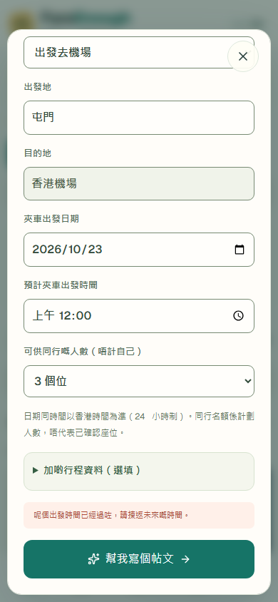
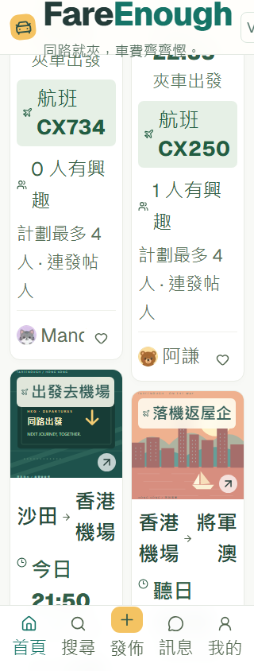
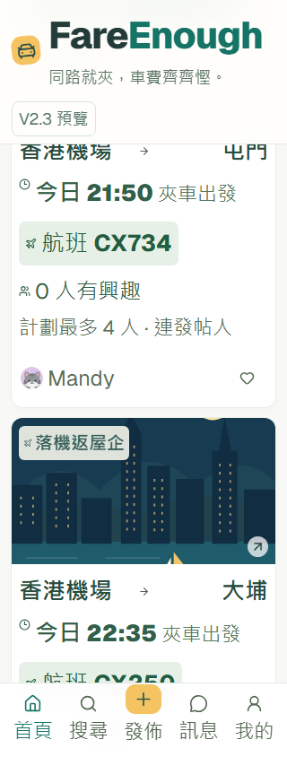

# FareEnough V2.3 — A1, A2 and A3 repair evidence

23 October 2026, Hong Kong time. Scope is limited to the three confirmed defects from the [original persona review at 923e8b8](https://github.com/tonylo0929/ridepod/blob/923e8b8/docs/ux-review/SYNTHETIC-PERSONA-TEST.md). The current airport direction selector from `5bf3847` is preserved. No booking, chat, verification, payment, scheduling or group-management features were added.

Reviewed UI commit: [`8d98f34072c70b6700751f4d92447aa2e6bc915b`](https://github.com/tonylo0929/ridepod/commit/8d98f34072c70b6700751f4d92447aa2e6bc915b). The evidence/package commit follows this tested checkout. Windows source hash: `bb383f62a13d23aa38d205e8ba658dc09fa3732243a971e5d184489d06523a17`, source clean at capture.

## Before reproduction

The pre-repair local production build at `5bf3847` reproduced all three issues using only fresh synthetic contexts and visible controls. [REPAIR-BEFORE.json](REPAIR-BEFORE.json) contains the exact returned text and geometry.

| Finding | Reproduced before repair |
| --- | --- |
| A1 | Browser Date fixed to 23 October 00:06 HKT. Select today at 00:00, advance and publish with optional flight absent → own journey published. |
| A2 | Computed text enlarged to 200% at 320px → scroll width **397**; at 390px → **432**. The header actions/version badge extended beyond the viewport. |
| A3 | Enlarged 320px first-card author intersected the absolutely positioned heart control. |

## Repairs

**A1 — complete departure timestamp, checked twice.** `validateDepartureTime` interprets the form's date and time as a Hong Kong instant using explicit UTC+08:00, independent of the host timezone. Its injectable clock defaults to `Date.now` and is read on every attempt. Step 1 and final publication both reject a past instant with exactly:

> 呢個出發時間已經過咗，請揀返未來嘅時間。

The selected date/time, optional details, custom title/body and cover remain intact. Errors receive focus and scroll into view. Past-day entries receive the same Cantonese application error rather than only a native minimum-date balloon. Native required-field checks remain. A minute-valued input denotes the start of that minute: exact equality is valid; 1 ms later is past. There is no hidden grace period, rounding or silent adjustment. Flight/exit chronology validation remains separate and unchanged.

**A2 — content determines the layout.** Header items wrap instead of overflowing a fixed-height row. Tabs, search, filters, headings, form actions and native fields can wrap/shrink within their containers. Grids use zero-minimum tracks. The existing masonry observer compares actual route text size with a potential two-column lane, then selects one column when the text cannot fit readably; measuring potential width avoids a reflow loop. Normal 320/390px feeds retain two columns. Navigation height reserves matching document space. Detail actions now scroll in normal flow, so a large action/disclaimer block cannot cover journey facts. No document-level clipping, content hiding or reduced test font size was introduced.

**A3 — author and heart have separate layout space.** The author and interest control are siblings in a wrapping, normal-flow card footer. The heart is no longer absolutely positioned over the author. The main journey opener references the visible author through `aria-describedby`; keyboard order remains journey → interest → next journey. Capacity and interest calculations are unchanged.

## Deterministic departure regression matrix

Two rendered-browser matrices run the following cases with optional flight schedule **absent** and **present** (18 recorded outcomes total). Browser Date is explicitly fixed from the visible form's demo date. Tests never depend on executing near midnight.

| Case | Fixed clock / selection | Required and observed result |
| --- | --- | --- |
| Yesterday | Today 00:06; yesterday 23:59 | Reject with exact Cantonese message; retain fields |
| Earlier today | Today 00:06; today 00:00 | Reject at Step 1; retain 00:00 |
| Exact boundary | Today 00:06:00; today 00:06 | Preview allowed |
| Immediately past | Today 00:06:00.001; today 00:06 | Reject |
| Later today | Today 00:06; today 09:00 | Preview allowed |
| Tomorrow | Today 00:06; tomorrow 00:00 | Preview allowed |
| Midnight | Today 23:59:59; tomorrow 00:00 | Preview allowed using the full date |
| Expires in preview | Preview 00:07 at 00:06; publish at 00:07:00.001 | Final publication rejected; custom title/body remain |
| Correct and retry | Manually change selected time to 00:08 | Publication succeeds; custom content retained |

The five additional clock-unit tests also cover 1 ms before the boundary, immutable input, and independent overnight flight timing. Existing nine airport/count/copy tests remain enabled, including exit/arrival/car order and absent optional information. P3 separately verifies car departure at 21:50 and takeoff at 00:17 the next day, then applies hard past-time assertions at both steps.

## Enlarged-text and native-zoom regression matrix

Each of the six runs checks **homepage cards, expanded airport filters, journey details, Create Step 1 and preview**: 30 screen-state checks. It traverses Tab/Shift+Tab after resizing, scrolls to primary actions and asserts the entire button fits inside both dialog and viewport, with centre and corner hit tests proving it is uncovered. The form is completed and published by keyboard. It also checks document/dialog horizontal overflow and author/control intersection. The four enlarged runs perform 20 additional axe scans with all configured AA rules enabled.

| Mode | Effective CSS viewport | Columns on homepage | Document scroll/client | Author/control collisions | Modal horizontal overflow / covered primary actions |
| --- | --- | --- | --- | --- | --- |
| Normal | 320 × 844 | 2 | 320 / 320 | None | None |
| Normal | 390 × 844 | 2 | 390 / 390 | None | None |
| Simulated 200% text | 320 × 844 | 1 | 320 / 320 | None | None |
| Simulated 200% text | 390 × 844 | 1 | 390 / 390 | None | None |
| Native Chromium 200% zoom | 320 × 844 | 2 | 320 / 320 | None | None |
| Native Chromium 200% zoom | 390 × 844 | 2 | 390 / 390 | None | None |

The text simulation snapshots computed sizes before doubling them, including `!important` labels. It marks instrumented elements so retained header nodes are not accidentally enlarged to 400% when moving to preview. Newly mounted dialog content is enlarged separately. SVG artwork is excluded. The product does not use these test attributes to choose its layout.

Native browser zoom is a separate test, using Chromium's [tab zoom API](https://developer.chrome.com/docs/extensions/reference/api/tabs#method-setZoom) in a disposable profile with a test-only, loopback-only extension, following [Playwright's extension launch method](https://playwright.dev/docs/chrome-extensions). Unzoomed viewports **640 × 1688** and **780 × 1688** become effective CSS viewports **320 × 844** and **390 × 844**. Tests assert native zoom **2**, DPR **2**, pinch scale **1** and CSS zoom **1**. This is actual Chromium tab zoom, not CSS zoom, a transform, pinch emulation or a claim about a physical device. No user profile or signed-in session is used; the extension is never imported by the application.

Exact per-state results, native metrics, action bounds, keyboard-stop counts and clock matrix outcomes: [REPAIR-REGRESSIONS.json](REPAIR-REGRESSIONS.json). Native-zoom PNGs use Chromium's surface-capture API because Playwright's viewport screenshot override mis-scales the already zoomed surface. The capture leaves device metrics and layout unchanged; it does not crop or edit the image after capture.

## Before / after screenshots

| Finding | Before | After |
| --- | --- | --- |
| A1: 00:00 at 00:06 HKT |  |  |
| A2: 320px text enlargement |  |  |
| A3: author/heart separation |  |  |

Additional curated evidence: [expiry at final publication](repair-screenshots/after-expired-at-publication.png), [native 200% zoom homepage](repair-screenshots/after-native-200-home.png), [native 200% zoom preview action](repair-screenshots/after-native-200-preview.png). The 390px simulated result is in the [persona gallery](persona-screenshots/06-390-text-200.png). Normal mobile/desktop screens and all nine cover cases are in [UX-REPORT.md](UX-REPORT.md).

## Results, remaining issues and handover

- `npm run build`: PASS.
- `npx tsc --noEmit`: PASS.
- Focused lint: zero warnings/errors. Full lint: zero errors and 44 existing warnings outside these repairs; no suppression added.
- `npm run ux:review`: **12/12 PASS**, approximately 1.3 minutes. Two logic project cases, two baseline viewport journeys and eight repair regressions. Twenty curated captures (2,587 KiB) and all 18 full-cover cases passed.
- `npm run ux:personas`: **7/7 completed executions**, 28.8 seconds. **21 diagnostic PASS / 0 FAIL / 2 WORKAROUND / 0 NOT TESTED**. Execution success and diagnostic success are separate. A1–A3 checks are now hard assertions.
- Automatic accessibility scans: zero violations. `color-contrast` remains in axe's incomplete/manual-review list for SVG/image backgrounds and paint/scroll overlaps; these items are retained, not suppressed. This is not an accessibility certification or screen-reader/user study.
- Source changes are confined to isolated V2 components/styles and test/report infrastructure. No production authentication, database, booking, payment, dispatch or deployment-protection setting was modified.

Family/group interpretation, recurring frequency, contact/confirmation/trust/safety and bilingual search remain the original human-testing hypotheses. No related systems or features were implemented. Client-side time validation relies on the browser clock and is not a server booking guarantee. Safari/Firefox, OS text scaling, screen readers, real devices and actual participants remain outside this technical test.

The draft PR links to the current deployment and Actions run. Full raw screenshots, observations, HTML reports and traces are uploaded as a seven-day Actions artifact; only curated PNGs and compact JSON/Markdown are committed. Local source/test execution logs distinguish an initial duplicate-tracing harness error from application defects; final production native-zoom tests passed after correcting that instrumentation.

**Next phase: run the prepared five-person study with real participants. Stop feature work after these repairs.**
