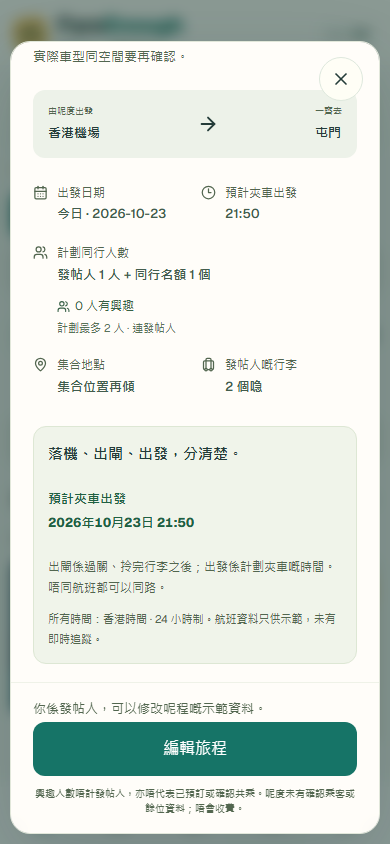
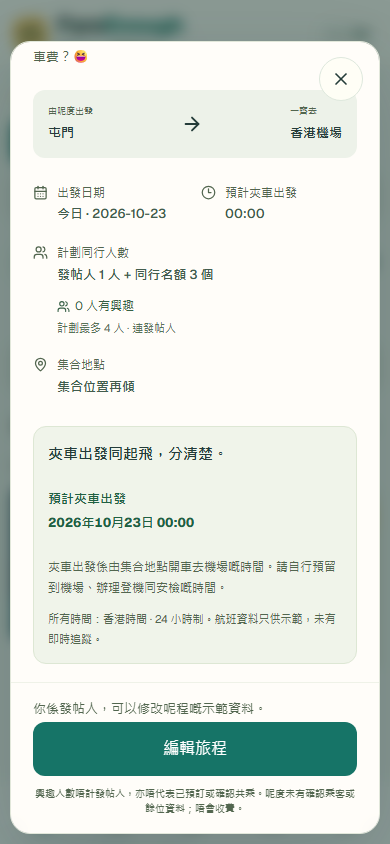
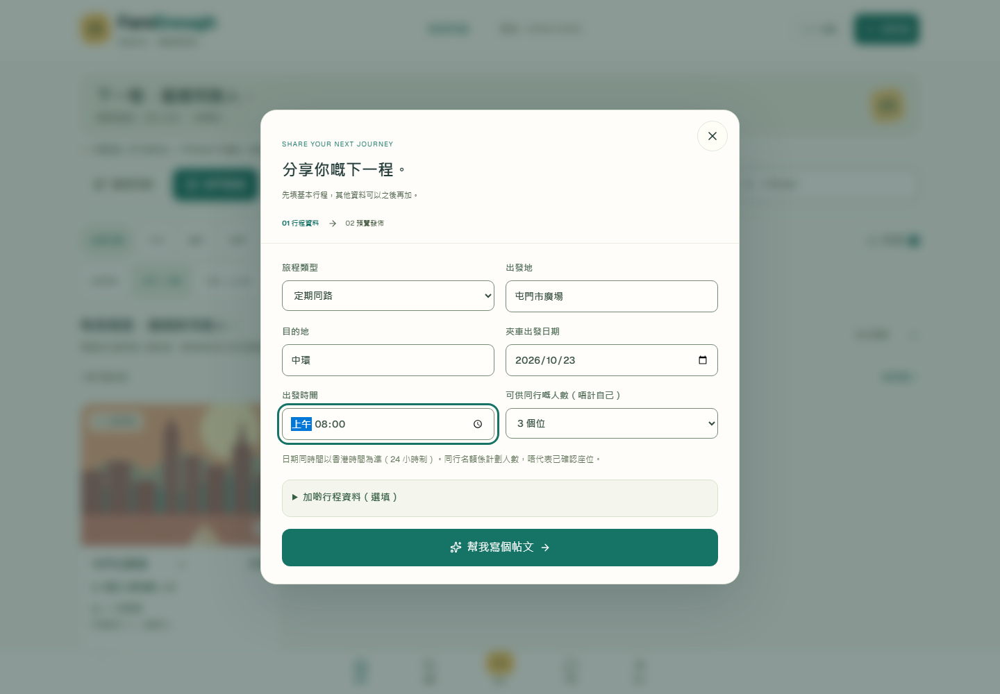
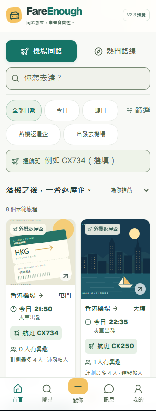
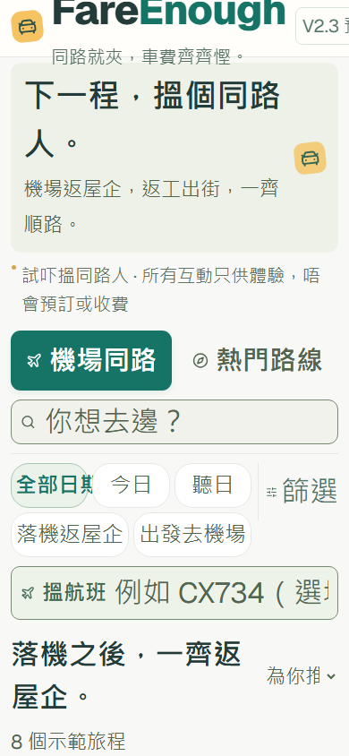

# FareEnough V2.3 — AI-driven exploratory browser testing

Tested **23 October 2026, 00:06–00:07 Hong Kong time** (22 October, 16:06–16:07 UTC). This is an actual rendered-browser exercise with synthetic demonstration data, not interviews or observations of six real people. No product fixes were implemented.

**Result:** six personas, **seven completed final scenarios**. Across 22 diagnostic task checks: **16 PASS, 4 FAIL, 2 WORKAROUND, 0 NOT TESTED**. The four failed checks identify three reproducible defects: past-time publication, enlarged-text overflow at two widths, and author/control overlap at 320px. Human comprehension and real-world suitability remain untested.

## Version, environment and boundaries

- Tested checkout: [`5177292ded8f62594cbc12c3df373ef6e0f05de8`](https://github.com/tonylo0929/ridepod/commit/5177292ded8f62594cbc12c3df373ef6e0f05de8), branch `feature/ridepod-social-discovery`.
- Last UI source commit: [`d31604f0e840062a5b42339c1cf76d0e6a79f77d`](https://github.com/tonylo0929/ridepod/commit/d31604f0e840062a5b42339c1cf76d0e6a79f77d). Preview/runtime/global styles/avatar source hash: `54b03a41f42d904e83b0585b45b3fde6951fec886a927b96aafd1bf688777d29`; no UI source changes during this exercise. The report/package commit follows the tested checkout.
- Node v24.14.0; Playwright 1.64.1; Chromium 156.0.8078.4; Windows; `zh-HK`; `Asia/Hong_Kong`; reduced motion; device scale 1.
- P1–P3/P5: 390 × 844 mobile emulation. P4: 1440 × 1000 desktop. P6: separate 320 × 844 and 390 × 844 mobile contexts.
- Fresh local production build at `http://127.0.0.1:3044/v2-preview`, fresh browser context per scenario, no imported cookies/account/session. Every persona starts at the plain homepage. No preselected journey URL, component functions, storage seeding or internal state injection bypassed navigation.
- Only supplied demo people and locally entered demo posts were used. The guard permits only local preview/static assets and GET/HEAD requests; production, API, auth and remote requests are blocked. **Zero blocked requests and zero browser errors** in all seven final scenarios. No production authentication, database, booking, payment or dispatch code was changed or exercised.
- The 200% exercise doubles computed text font sizes after taking a snapshot of all initial sizes; it excludes SVG artwork. A newly opened filter dialog is enlarged separately. This is explicit test instrumentation, **not native browser zoom**, OS text scaling or a screen-reader test. No content is hidden for captures.

Read alongside the [automated UI inventory and 20-state audit](UX-REPORT.md), [human usability-test package](USABILITY-TEST.md), and [raw action/observation evidence](PERSONA-EVIDENCE.json).

## Results and measured automation time

Times below cover the fixture's homepage navigation, actions, observations and screenshots. They exclude browser launch/build and are **automation durations**, not human task times, usability benchmarks or estimates of how quickly a participant would finish. The final Playwright run, including build/launch/teardown, took 27.6 seconds.

| Scenario | Viewport | Automation time | Task outcomes | Overall observed outcome |
| --- | --- | --- | --- | --- |
| P1 First-time airport traveller | 390 × 844 | 725 ms | 2 pass | Found CX734, expressed interest and found it in My Journeys; English search needed recovery |
| P2 Family and two large cases | 390 × 844 | 894 ms | 1 pass, 1 workaround | Published; existing-party intent was only in free text and conflicted with the selected structured count |
| P3 Overnight traveller | 390 × 844 | 1,162 ms | 3 pass, 1 fail | Overnight dates/flight chronology worked; already-past same-day departure published |
| P4 Recurring commuter | 1440 × 1000 | 1,129 ms | 1 pass, 1 workaround | Found a recurring post; weekday frequency was described in free text |
| P5 Trust-conscious passenger | 390 × 844 | 757 ms | 2 pass | Status/meeting information and chat limitation were visible; identity/safety workflows were absent |
| P6 Small screen and keyboard | 320 × 844 | 1,234 ms | 3 pass, 2 fail | Keyboard/recovery worked; enlarged text overflowed and author overlapped interest control |
| P6 Small screen and keyboard | 390 × 844 | 1,161 ms | 4 pass, 1 fail | Keyboard/recovery worked; enlarged text overflowed; sampled author/control did not overlap |

**Execution status differs from diagnostic task outcome.** Playwright reports 7/7 executions passed because all exploration steps completed safely. `session.check()` records a finding without aborting exploration; it is not an assertion that the UX is acceptable. The existing `ux:review` accessibility/behavior assertions remain enforced and were not suppressed.

## Persona observations and exact task sequences

The numbered actions below correspond to `sessions[].actions` in [PERSONA-EVIDENCE.json](PERSONA-EVIDENCE.json). That file contains actual returned text, accessible snapshots, validation messages, focus stops, geometry, timestamps, screenshot paths and trace paths. It is the detailed action log; these summaries do not represent participant statements.

### P1 — first-time airport traveller

**Task:** find a CX734 arrival journey to Tuen Mun, check timing/places, express interest and find it later.

1. Open the normal V2 homepage. Type `Tuen Mun` in **搜尋目的地或旅程**: zero cards and the empty-state heading appeared. Capture the empty state.
2. Click **清除搜尋**. Type the incorrect flight `CX9999`: zero cards. Replace it with `cx 734`: exactly one matching card appeared.
3. Click that visible 香港機場 → 屯門 card. Read full detail: CX734 scheduled arrival **20:50**, estimated exit **21:30**, planned car departure **21:50**, **3 companion places**, **maximum planned group 4 including the poster**.
4. Scroll to **我有興趣** and click. Detail changed from 0 to **1 interested person**; planned maximum stayed 4.
5. Click **關閉**, then bottom-navigation **我的**. The interested airport/Tuen Mun journey appeared with the updated count.

**Outcome:** main discovery/interest/retrieval tasks PASS. Wrong-flight recovery worked. English place search did not match the Cantonese fixture; bilingual discoverability is **B4, Low, a hypothesis**, not a promised-language defect. Reading the labels does not establish that a human understands them. [Screenshot](persona-screenshots/01-interested-journey-found.png); trace/log P1.

### P2 — traveller with family and luggage

**Task:** explore two-adult/two-large-case suitability, filters, optional fields and post validation.

1. Open **篩選**. Select **想搵幾多個同行名額？ → 最少 2 個**. Open **更多條件**. Observe that the luggage field asks about **the other poster's bags**, not available vehicle storage.
2. Select **對方最多帶幾多個喼？ → 2**, then click the result-count Apply button. Filtering completed; it did not establish vehicle fit.
3. Open **發佈**. Set destination to **香港機場**, identical to the origin, and click **幫我寫個帖文**. The application showed `請填寫唔同嘅出發地同目的地。` and stayed on the form: PASS.
4. Correct destination to **屯門**. Set **可供同行嘅人數（唔計自己） → 1 個位**, intending one new companion in addition to the two existing adults. Open optional details, select **2 bags**, and enter `示範：我哋兩位成人，兩個大喼，想再搵一位同路人；實際車型同空間要再確認。`.
5. Preview and click **發佈示範帖文**. Detail retained the two-adult free text and 2 bags, but the structured summary said **發帖人 1 人 + 同行名額 1 個 / 計劃最多 2 人**. Scroll the detail facts into view and capture them.

**Outcome:** creation/validation worked. Representing the intended party required free text and left an inconsistent selected summary: WORKAROUND, **B1, Medium**. The label could also be interpreted as counting the accompanying adult among companion places; this test does not prove that every possible input combination is incapable of expressing three people. The missing distinction is already-accompanying people versus newly sought companions. No suitcase dimensions, car type, luggage capacity, allocation or confirmed seats were available to validate. [Screenshot](persona-screenshots/02-family-count-and-luggage.png); trace/log P2.

### P3 — late-night traveller

**Task:** distinguish car and flight dates across midnight and try inconsistent/past dates and times.

1. From home click **出發去機場**, then the visible **沙田 去 香港機場** card. Its timeline showed **23 October 21:50** car departure and **24 October 00:17** flight departure; scroll and capture the full-date timeline.
2. Close, open **發佈**, choose outbound direction. The default departure date was `2026-10-23`. Enter yesterday, `2026-10-22`, and submit. Native validation rejected it (`rangeUnderflow: true`, `Value must be 2026/10/23 or later.`): PASS. Correct the date.
3. Enter **21:50** car departure and optional flight departure **2026-10-23T00:17**. Submit: application rejected takeoff before car departure with `去機場嘅夾車出發時間要喺航班預定起飛之前。`: PASS.
4. Change only flight date to **2026-10-24T00:17**. Preview; expand **核對航班時間**. The independent dates and 21:50/00:17 values were retained: PASS.
5. Click **返回修改**. Enter **00:00** on `2026-10-23`, clear the optional flight schedule, and submit. Browser clock was **2026-10-23 00:06:49 HKT**, so departure was already past. Preview accepted it, and **發佈示範帖文** published an own journey showing **今日 · 2026-10-23 / 00:00**: FAIL, **A1, Medium**. Scroll date/time facts into view and capture.

The clock was observed, not frozen. The evidence records ISO time, Hong Kong date and epoch; future runs mark this particular check NOT TESTED if the entered time is not actually past. [Past-time screenshot](persona-screenshots/03-same-day-past-departure.png); overnight screenshot and trace/log P3 in the full artifact.

### P4 — daily commuter

**Task:** find a recurring Tuen Mun–Central journey, try search/filter recovery, create a recurring post.

1. From the desktop homepage click **熱門路線 → 屯門 → 中環 → 定期同路**. One recurring fixture remained: 屯門市廣場 → 中環, tomorrow 07:45: PASS.
2. Type the deliberately unmatched search `屯門去中環xyz`: zero cards. Click **清除搜尋**: the one corridor/recurring result returned, preserving those filters.
3. Click **發佈**, choose **定期同路**, enter **08:00**. Inspect the rendered controls: one departure date/time, no weekday/frequency/end-date control. Capture the form.
4. Open optional details and enter `示範：想星期一至五朝早八點由屯門返中環。每次是否成行要再確認。`. Preview and publish. The weekday description appeared in the post.

**Outcome:** finding and posting worked. Expressing recurring weekdays required free text: WORKAROUND, **B2, Medium**. No generated recurring schedule was observed or assumed. Existing category copy also says these are passenger corridors, not fixed services or dispatch. [Screenshot](persona-screenshots/04-recurring-single-date-form.png); trace/log P4.

### P5 — trust-conscious passenger

**Task:** inspect organizer, group/interest/confirmation, meeting, cancellation and safety explanations.

1. From home open the first visible airport journey. Detail named **Mandy**, explicitly a **示範人物**, with 3 companion places/max 4 and meeting point **一號客運大樓，抵港接機大堂 B**; one bag and a 20-minute wait were shown.
2. Unexpected action: click the organizer's visible name. URL and the one detail dialog remained unchanged; no profile or verification view opened.
3. Click **我有興趣**, then **撤回興趣**. Interest changed **0 → 1 → 0** while planned maximum stayed 4. The disclaimer stated interest is **not booking or confirmed sharing** and that confirmed passenger/remaining-seat data is unavailable: PASS for the observed status behavior/copy.
4. Scroll meeting/group facts into view and capture. Express interest again, close details and open **訊息**. A shortlist appeared with `真人聊天會喺之後開放`; no live chat opened: PASS for locating that limitation.

**Outcome:** available meeting/status information and non-booking wording were present. In this journey/dialog/shortlist, no verification workflow, cancellation procedure or safety/reporting action was exposed. These are current demo limitations and **B3, Medium** UX questions, not evidence that the sample person is safe/unsafe or that any booking exists. [Screenshot](persona-screenshots/05-message-shortlist-not-chat.png); trust detail screenshot and trace/log P5 in the full artifact.

### P6 — keyboard, enlarged text and small screens

**Task:** repeat independently at 320px and 390px; check focus/order, readability, controls, scroll, validation and recovery.

1. Start at the plain homepage. Press successive **Tab** keys to the first journey card. Press **Enter** to open details. Record the application's initial focus, six **Tab** and six **Shift+Tab** stops; focus stayed in the dialog. **Escape** closed it and restored the exact original card opener: PASS at both widths. No programmatic `.focus()` moved the test to a desired starting control.
2. From that restored card, **Tab** reached its separate interest button, then the next DOM card (大埔): PASS. Record all eight cards' DOM-order headings and visual rectangles. Both widths had alternating left/right row progression, rather than whole-column reading order. This does not establish screen-reader comprehension.
3. Open **發佈**, clear required destination and submit. Native `valueMissing` was true. Type **屯門** and resubmit; preview appeared: PASS at both widths. Close and return Home.
4. At normal text size, document scroll width equaled client width (320/320 and 390/390). All measured, rendered homepage `button/input/select/summary` controls had both dimensions at least **44 CSS px**. This sample excludes hidden controls, links, other screens and device motor testing; it is not an exhaustive accessibility pass.
5. Double computed font sizes for existing text/control elements; H1 changed **18px → 36px**, with 154 elements instrumented. At 320px, document scroll width became **397px**; at 390px it became **432px**: two FAIL checks, **A2, High**. The screenshot is clipped by the real viewport, not cropped afterward.
6. Compare the first card author and interest-button rectangles. **320px: overlapping**; **390px: no overlap** in this sample. The 320px failed check is **A3, Medium**. Scroll the enlarged author into view for a separate evidence capture.
7. Open **篩選**, double the newly mounted dialog text separately (heading **21px → 42px**, 40 elements), scroll to the result-count Apply control, and close with **Escape**. Both operations completed. This step did not measure every filter's overlap or claim complete large-text form coverage.

[320px baseline](persona-screenshots/06-320-baseline.png), [320px enlarged header](persona-screenshots/06-320-text-200.png), [320px author overlap](persona-screenshots/06-320-author-overlap.png), [390px enlarged header](persona-screenshots/06-390-text-200.png); trace/log P6 at each width.

## A. Verified functional defects

| ID | Severity | Reproduction and observed evidence | Scope and diagnosis after reproduction |
| --- | --- | --- | --- |
| A1 | Medium | P3: today at 00:00, real clock 00:06:49 HKT, no flight schedule → preview → publish succeeds. Screenshot and clock/action records above. | Preview only. The date input has `min={today}` but the time input has no current-time restriction; Step 1 and publishing call airport chronology validation, which does not compare departure with now. See [create-post.tsx](../../src/app/v2-preview/create-post.tsx) and [data.ts](../../src/app/v2-preview/data.ts). No live past booking occurred. |
| A2 | High | P6: normal text has no horizontal overflow. Under the documented 200% text simulation, scroll/client width is 397/320 and 432/390. Header/control content extends past the viewport. | Reproduced in both final mobile contexts and earlier harness runs. This establishes a layout defect under this text-resize method; native zoom/OS scaling still require separate verification. No claim of a complete WCAG audit. |
| A3 | Medium | P6 320px: first-card `Mandy` label and separate interest control intersect after enlargement; screenshot and rectangle predicate confirm it. Same sample at 390px did not intersect. | Fixed author reservation and absolute heart positioning are constraints to investigate: [preview.module.css](../../src/app/v2-preview/preview.module.css) uses 38px right author padding and a 44px control. A complete root-cause fix was not attempted. |

No Critical issue was established. Severity reflects observed access/workflow impact in the demo; no loss of real bookings, money or customer data was observed.

## B. UX hypotheses requiring human validation

| ID | Severity | Observed basis | Hypothesis and practical limit |
| --- | --- | --- | --- |
| B1 | Medium | P2: two existing adults + one newly sought companion described in body, while selected 1-place summary produced max 2. Luggage filter counts the poster's bags. | Existing companions versus newly available places may be misread. First clarify counting with a family example; consider separate party fields only if testing supports them. Nothing here proves vehicle/suitcase fit. |
| B2 | Medium | P4: recurring category with one date/time; weekdays entered in body. | Readers may expect an actual schedule from the recurring badge. Clarify that frequency is descriptive and each trip needs agreement; validate whether more controls are necessary before adding them. |
| B3 | Medium | P5: organizer click had no effect; details provide meeting/status disclaimer; Messages is a shortlist with future-chat notice. | After expressing interest, a reader may still lack an actionable next step for contact, agreement, cancellation or safety concerns. Explain the demo boundary near the action; do not imply verification/confirmation exists. No false-confidence reaction was observed from a person. |
| B4 | Low | P1: `Tuen Mun` gave no result; `cx 734` matched. | An English-searching traveller might miss Cantonese fixtures. No bilingual-search promise was found in the tested interface. Test expectations with participants before expanding search aliases. |

## C. Untested assumptions and limitations

- **No human participants, interviews, quotations, emotions, satisfaction scores, conversion rates, market validation or representative completion rates.** Automated durations are not evidence of ease of use. The prepared [five-person study](USABILITY-TEST.md) has not been conducted.
- Cantonese comprehension, interpretation of capacity/interest/recurring labels, confidence, safety expectations and discovery without test author knowledge require actual people. These flows were prepared from rendered controls and prior UI inventory; they are not unassisted human discovery.
- No real flights, flight reliability, fares, physical vehicle fit, luggage dimensions, confirmed passenger capacity, identity, booking, chat, driver, payment, cancellation operation or dispatch service was verified.
- No native browser zoom, OS enlarged-text setting, real device, iOS/Safari/Firefox, screen reader, voice control, switch access or disabled-participant testing. P6 is a technical Chromium simulation. Keyboard traversal sampled the first two cards and the journey modal; the baseline suite also checks masonry ordering/focus. Not every screen/combination was audited at 200%.
- No backend persistence was assumed. Posts and interests belong to fresh demo contexts. Nothing establishes cross-session, multi-user or production behavior.
- Date-sensitive fixtures roll forward. The baseline 20-state review was captured before Hong Kong midnight (22 October); final persona scenarios used 23 October. P3 records its actual clock/date rather than reusing the baseline date anchor.

## Five recommended improvements, ranked

These are proposed changes for a later decision. **None was implemented in this testing package.**

| Rank / priority | Problem and evidence | User impact | Recommended correction | Verify before accepting |
| --- | --- | --- | --- | --- |
| 1 / P1 | Enlarged text overflows at both widths; author/control overlap at 320px (A2/A3, P6). | Enlarged content/control labels can be clipped or collide. | Allow header/filter/card text to wrap and controls to reflow; reserve space according to content rather than fixed author padding. Preserve the normal masonry appearance. | Repeat 320/390px text-resize cases with no document overflow or author/control intersection; add native 200% zoom/text-setting checks and keyboard review. Keep existing contrast/name gates. |
| 2 / P1 | Same-day past departure can be published although yesterday is rejected (A1, P3). | A newly posted journey may already be unusable. | Validate combined departure date/time against an explicit Hong Kong clock in both preview and publish; retain entered data and show an actionable error. Define any grace policy before coding. | Fixed-clock tests for just-past/now/future, next-day midnight, optional flight absent/present; rendered form recovery; preserve overnight chronology tests. |
| 3 / P1 | Existing-party/new-companion meaning is ambiguous (B1, P2). | A family may advertise a count inconsistent with its own plan. | Start with an explicit Cantonese example explaining where the accompanying adult is counted and what luggage data means. Validate the need for separate existing-party/new-place inputs. | In the human study ask two adults seeking one extra companion to explain and enter the total; compare selected summary with their intent. Do not infer taxi fit. |
| 4 / P2 | Recurring badge exposes one date/time without a structured frequency (B2, P4). | Readers may assume dates/services that were never agreed. | Clarify descriptive recurring intent and make the next departure and agreement requirement explicit. Add scheduling controls only after evidence of need. | Have commuters state which day/time this post applies to and how another day is agreed; verify no wording implies fixed service or generated bookings. |
| 5 / P2 | Interest has no available contact/confirmation pathway; organizer click is inert (B3, P5). | The next step and limits of trust may remain unclear. | Explain immediately after interest that this demo cannot contact/verify/confirm; provide concise meeting/agreement/cancellation expectations appropriate to the demo. Do not add or imply live booking/verification. | Ask participants what happened, whether a seat is confirmed, what they can do next, and what safety/cancellation support exists. Check their answers against actual capabilities. |

## Automated checks and CI status

| Check | Result |
| --- | --- |
| Previous checkout CI | [Run 39801775127](https://github.com/tonylo0929/ridepod/actions/runs/39801775127), job 119904111083: **cancelled during Install Chromium and CJK fonts**. Lint, application tests and artifact upload were skipped; no application-test pass/fail can be inferred. |
| `npm run ux:review` rerun locally | **PASS**, 3/3 project tests, 44.5s. Nine timing/count/copy assertions plus network-boundary checks; 20 curated mobile/desktop captures; all 18 nine-cover rendering cases; zero automated audit violations, browser errors or blocked requests. Includes a fresh successful Next production build and its TypeScript check. |
| `npm run ux:personas` | **7/7 completed final executions**, 27.6s. 22 diagnostic checks: 16 PASS / 4 FAIL / 2 WORKAROUND. The exporter was then run successfully against these results; its subsequent addition to the npm command reuses the same output and does not rerun browsers. |
| `npx tsc --noEmit` | **PASS**. |
| Focused ESLint: preview, both Playwright configs, review scripts/tests, `--max-warnings 0` | **PASS**, zero warnings/errors. |
| `npm run lint` | **PASS exit code**, zero errors; 44 existing warnings outside the new review infrastructure. No warning suppressions added. |

The revised GitHub workflow runs both suites sequentially and uploads raw screenshots, `observations.json`, JSON/HTML reports and all seven traces as a seven-day Actions artifact. CI success means the exploration completed and existing enforced assertions passed; diagnostic UX failures must still be read from the evidence. Check the PR's current run for remote status rather than treating this local report as a remote CI result.

Harness audit: three seven-scenario passes were attempted (21 executions total). The first had 3 complete and 4 interrupted by incorrect test locators, not application failures. The next two completed 7/7 each. The final pass added natural focus-cycle/order checks, separately enlarged new dialog content and an author-overlap screenshot. Only the final seven are included in task totals and curated evidence. The first midnight probe was not yet past the real clock; it was not counted as a defect. The final 00:00 probe is supported by the recorded 00:06:49 clock. Preliminary locator failures were corrected in test code only.

## Reproduce, inspect evidence and hand over

```sh
npm ci
npx playwright install chromium
npm run ux:review
npm run ux:personas
npx playwright show-report playwright-report/persona-review
```

`ux:personas` starts its own fresh build/server (default local port 3044; set `FAREENOUGH_UX_PORT` to another unused local port if necessary). It exports [PERSONA-EVIDENCE.json](PERSONA-EVIDENCE.json) and nine curated PNGs in `persona-screenshots/`, bounded to 1.5 MiB (this run: **669 KiB**). It requires all seven executions and the network/browser-error gates to pass before exporting. It does **not** rewrite this analyst report or assert that diagnostic findings have been fixed. Reassess the report and outcomes after future UI changes.

The complete run keeps 14 screenshots, seven `trace.zip` files, exact observations and Playwright JSON/HTML under ignored `test-results/persona-review/` and `playwright-report/persona-review/`. In the PR, open the **FareEnough UX review** Actions run and download `fareenough-ux-review-<run_id>` (seven-day retention). Trace paths are recorded per scenario in the JSON. Download/unzip the artifact, then inspect a trace locally, for example:

```sh
npx playwright show-trace "test-results/persona-review/<scenario-directory>/trace.zip"
```

No large trace archive or browser report is committed. Relative image links below render directly in the GitHub report/PR. The complete local evidence archive is also supplied with the handover.

## Curated screenshots

P1: interested journey found afterward.


P2: selected structured group count and luggage; existing two-adult intent is recorded in the action log/body.



P3: already-past same-day 00:00 departure was published.



P4: recurring type exposes a single date/time on desktop.



P5: Messages explicitly describes future live chat.


P6: 320px normal text, followed by enlarged text at the same viewport width.

| 320px normal text | 320px doubled text |
| --- | --- |
|  |  |

P6: scroll to the 320px author/control collision; enlarged header at 390px also overflows.

| 320px enlarged author/control | 390px doubled text |
| --- | --- |
|  |  |

**Recommended next action:** review the ranked findings, decide the scope of the resize/time corrections, then run the prepared five-person human study before adding features. This exercise ends at evidence and recommendations. Draft PR remains unmerged; production remains unchanged.
