# FareEnough V2.3 — automated UX review

Generated: 2026-10-23T11:41:14.251Z (UTC). **PASS — complete package**. This is captured evidence and a product inventory, not an accessibility certification or a pixel-diff baseline.

## Version and reproducibility

- Reviewed UI source commit: [`8d98f34072c70b6700751f4d92447aa2e6bc915b`](https://github.com/tonylo0929/ridepod/commit/8d98f34072c70b6700751f4d92447aa2e6bc915b).
- Generation checkout: `71ab0799ccfb4ff48cc1b551a5111c88008a0123`; branch: `feature/ridepod-social-discovery`.
- UI source files modified/untracked at capture: **no**.
- SHA-256 of preview/runtime/global styles/avatar source files: `bb383f62a13d23aa38d205e8ba658dc09fa3732243a971e5d184489d06523a17`.
- Toolchain: Node v24.14.0, Playwright 1.64.1, Chromium 156.0.8078.4, win32.
- Viewports: mobile **390 × 1100**, desktop **1440 × 1000**, device scale 1, zh-HK locale, Asia/Hong_Kong timezone, reduced motion. PNG viewport captures; modal interiors are scrolled where noted. No content is hidden for screenshots.
- Server demo date anchor(s): 2026-10-23. “今日/聽日” roll forward on future runs. Each run starts a fresh local production build and new isolated contexts; no saved sessions are loaded.
- The package commit necessarily follows the reviewed checkout because generated files cannot contain their own Git hash. The UI source commit/hash above identify what is pictured. CI artifacts record the actual tested checkout.

## Screens and navigation

The product is a passenger-led, Cantonese journey-discovery demo under `/v2-preview`. FareEnough uses mint, cream and warm yellow, route illustrations and animal avatars. Phones use two masonry lanes; desktop uses four.

| Screen | Reach it | Available actions |
| --- | --- | --- |
| Home / airport feed | Default category; 首頁 returns to top | Search text, today/tomorrow, direction, flight filter, sorting; open cards or express interest |
| Airport filters | 篩選 | Common date/district/planned places/direction; optional 更多條件 for earliest car departure, luggage, waiting and flight |
| Popular routes | 熱門路線 tab | Corridors, morning/evening, recurring journeys and shared search/sorting |
| Journey details | Card; sample query `?journey=demo-1` | Route, author, planned group size, interest, meeting/luggage/waiting and independent airport times |
| Create Post — step 1 | 發佈, 分享行程 or 分享下一程 | Essential trip fields; optional flight/exit/luggage/wait/meeting/message disclosure |
| Create Post — step 2 | 幫我寫個帖文 | Compact route/car departure summary, editable title/body, optional full flight timeline/number and cover, normal-flow publish action |
| Own journey | Publish, then view; or 我的 | Creator label and local edit; no self-interest action |
| My Journeys | 我的 | Published/interested counts and lists; refresh warning |
| Message shortlist | 訊息 | Revisit interested journeys; text explicitly says real chat is unavailable |

## User journey flows

1. **Find company:** home → airport text/flight search or popular corridor → optional filters → journey details → 我有興趣 → My Journeys / message shortlist. 撤回興趣 removes the local intention.
2. **Share a journey:** 發佈 → essential fields → optional details → generated preview → edit copy/cover → publish → creator-labelled detail → optional local edit → My Journeys. Editing retains the post ID and published count.
3. **Understand airport timing:** arrival details prioritize estimated exit after immigration/bags and planned car departure; the flight schedule stays separate. Outbound sample departs at 21:50 and takes off at 00:17 on the next full date, in Hong Kong time.
4. **Recover:** clear filters from an empty result; Escape closes native dialogs. Refresh resets session activity; a local-post query link then shows an explicit expired-demo notice.

Interest excludes the one host. Maximum planned group size is the host plus advertised companion places. Interest does not consume seats or confirm a booking. Filtering advertised places is independent of interest.

## Mock-only versus live features

| Working in the local demonstration | Not connected to a live service |
| --- | --- |
| Client-side filters/sorting; native modal navigation; optional flight tags; chronology checks; editable template text; cover choice; local create/edit; interest/withdrawal; session-derived lists/counts | Real rider records, identity verification, confirmed seats, booking, driver matching, dispatch, live flight status, real messaging, fares/payments, persistence or cross-device sync |

All fixture people, posts, flight examples and interactions are synthetic. “Live” behavior here means reactive browser UI only. The production app exists elsewhere in this repository and is outside this review. No production/customer pages, auth/account screens or API endpoints are visited. Tests block non-GET/HEAD, non-local, API/auth and unapproved asset requests. No cookies/profile are imported, and no credentials or personal data are entered. Only supplied demo avatar images may use the local Next image optimizer.

## Test results

Run duration: 79.4 seconds. 20/20 curated images; 2587 KiB total; 4 MiB budget **passed**; capture completeness **passed**.

| Test | Status | Duration |
| --- | --- | --- |
| logic: departure validation uses an injectable Hong Kong clock | passed | 0.1s |
| logic: airport/count logic and capture network isolation | passed | 0.1s |
| mobile: curated preview review journeys | passed | 14.6s |
| desktop: curated preview review journeys | passed | 16.1s |
| repairs: A1 fixed-clock form matrix; optional flight absent | passed | 2.1s |
| repairs: A1 fixed-clock form matrix; optional flight present | passed | 2.2s |
| repairs: A2/A3 normal at 320px: home, filters, detail and creation | passed | 1.8s |
| repairs: A2/A3 normal at 390px: home, filters, detail and creation | passed | 1.8s |
| repairs: A2/A3 text-200 at 320px: home, filters, detail and creation | passed | 4.3s |
| repairs: A2/A3 text-200 at 390px: home, filters, detail and creation | passed | 4.3s |
| repairs: A2/A3 native-zoom-200 at 320px: home, filters, detail and creation | passed | 5.0s |
| repairs: A2/A3 native-zoom-200 at 390px: home, filters, detail and creation | passed | 4.9s |

The logic test executes the nine airport/count/copy assertions in `scripts/test-v2-airport-timing.mjs`, plus allow/deny cases for the capture network boundary. Playwright's web server runs `npm run build` (including Next's TypeScript check) before browser tests; a failed build prevents capture. This report does not imply that every production flow or repository test was run.

The post-persona repair project adds five deterministic departure-clock unit tests and eight browser regressions. Its two departure matrices cover yesterday, earlier today, exact equality, 1ms past, later today, tomorrow, midnight, expiry during preview, preserved input and recovery, with optional flight time absent/present. Browser clocks are fixed explicitly; a selected minute means its start, with no hidden grace period.

Six layout runs cover normal text, simulated 200% text, and actual Chromium 200% tab zoom at effective widths 320/390px. Native zoom uses a test-only local-host extension in a disposable Chromium profile; starting viewports 640/780px become CSS viewports 320/390px, with zoom factor 2, DPR 2, pinch scale 1 and CSS zoom 1 asserted. Each run checks the homepage, expanded filters, details, creation and preview, keyboard reachability, uncovered actions, document/dialog overflow and author/control separation. Enlarged runs retain all axe rules. See [repair evidence](REPAIR-REGRESSIONS.json) and the [repair handover](POST-PERSONA-REPAIRS.md). This is technical regression evidence, not a human accessibility certification.

The nine original cover scenes retain their normal masonry treatment. Normal mobile feeds remain two columns; when actual text size cannot fit a readable two-column lane, the feed reflows to one. Author and interest controls use separate normal-flow footer items; detail actions scroll with the content. No journey information is hidden to satisfy layout assertions.

Both flight inputs are checked with an invalid character and a valid synthetic flight number. The initial review exposed an unescaped hyphen in their HTML pattern under Unicode-aware browsers; the focused V2 fix is included in the reviewed UI source commit. The suite requires zero browser errors and verifies that the pattern rejects invalid input. See the [HTML pattern standard](https://html.spec.whatwg.org/multipage/input.html#the-pattern-attribute).

| Browser flow/assertions | Mobile | Desktop |
| --- | --- | --- |
| Homepage: synthetic feed, responsive masonry and no overflow | passed | passed |
| Airport direction: friendly buttons preserve search/date/flight and synchronize filters | passed | passed |
| Airport search: route text and normalized optional flight | passed | passed |
| Airport filters: planned places and district, native-dialog keyboard audit | passed | passed |
| Popular routes: corridor, recurring filter and empty recovery | passed | passed |
| Journey details: arrival/exit/car times, optional flight and Escape | passed | passed |
| Outbound example: car and takeoff keep independent full dates | passed | passed |
| Create step 1: essentials work with optional fields empty | passed | passed |
| Create step 2: preview, edited copy survives back navigation, publish | passed | passed |
| Own journey: local edit updates the same post with no self-interest | passed | passed |
| Interest before/after: add and withdraw without changing capacity | passed | passed |
| My Journeys and message shortlist: real session counts, demo notices | passed | passed |
| Refresh: local posts expire and both activity counters reset | passed | passed |
| All nine detail covers: full artwork, uniform scale, bounded height and unchanged feed fit | passed | passed |

No horizontal page overflow is required at every capture point. Browser errors observed: **0**. Forbidden network attempts observed: **0**. A forbidden attempt fails the run before publication.

Detail-cover correction: **18/18** checks cover all nine existing illustrations at 390×844 mobile and 1440×1000 desktop. ViewBox corner transforms must remain inside the visible SVG frame with uniform scaling; the cover is capped at 320px / 36% of viewport height, and the badge/close control must not obscure artwork. Detail uses containment; feed covers retain their existing crop. Eighteen per-cover screenshots and geometry results stay in the Actions artifact, outside the curated 20-image binary budget. The gallery's journey-detail image shows the top of the modal.

## Accessibility and usability findings

Automated axe scans run at every captured state and the expanded filter/cover states against WCAG 2 A/AA, 2.1 A/AA and 2.2 AA tags (46 scans). **Contrast and visible-label/name mismatches are mandatory regression gates**; all other findings are also reported. Duplicate occurrences across states are counted, not unique UI defects. No audit rules are disabled or excluded. Incomplete rules requiring human review: **color-contrast**; element-level findings are retained in the JSON artifact. Zero automatic violations does not establish full WCAG conformance.

| Automated rule | Impact | Affected audited states | Node occurrences across states | Example selector |
| --- | --- | --- | --- | --- |
| No automatic violations detected in completed scans | — | 0 | 0 | — |

- **Touch-size advisory:** mobile “首頁” 32×46px; mobile “搜尋” 32×46px; mobile “訊息” 32×46px; mobile “我的” 32×46px These are a small visibility-based sample, not a WCAG target-size conformance result; spacing exceptions and overlap need human assessment. Prefer larger touch areas where practical.
- **Keyboard:** Tab/Shift+Tab explicitly cycle between the first/last eligible dialog controls; the regression fails on a body/background stop. Escape is exercised. Both tested boundary directions remained in the dialog. Escape restored the arrival-card opener at both widths. Create step changes focus their heading and return to the top. A screen-reader session and every modal/assistive-technology path remain untested.
- **Masonry reading order:** cards use a flat DOM and a sparse row-flow grid with measured heights, preserving two/three/four columns. Tests compare every source-ordered card's top/left position, check same-column separation and Tab progression to the next visual card. The previous whole-column DOM order was replaced. Human screen-reader comprehension still requires evaluation.
- **Mobile usability:** duplicate post copy moved to details; route, departure, optional flight and independent interest/capacity stay in cards. Common filters remain visible and advanced options are disclosed. Main filter/input/icon targets are at least 44px. Step 2 uses a compact cover/route summary, editable copy and optional timing/cover disclosures; its publish control is in document flow. Detail screenshots show scrolled interiors. Verify disclosure comprehension and action discoverability with people and enlarged text.

## Known limitations and review guidance

- This workflow uses Chromium at two widths, not every browser/device. No pixel equality assertions: OS/CJK fonts, browser updates, current demo dates and rendering can alter images. CI installs CJK fonts; Windows and Linux may render differently.
- Native date/time inputs follow browser/OS formatting; zh-HK Chromium can show 上午/下午 even though values and full-date summaries use Hong Kong 24-hour times. Native input formatting and the Step 1 format hint need human usability review.
- Source-driven labels and synthetic fixture routes are intentional test contracts. If the product's screens or accessible names change, update the scenarios and this product inventory rather than weakening assertions.
- Captures are viewport images, not exhaustive full-page composites. Use the report's flow descriptions, the local UI and test traces to inspect content beyond the fold.
- Automated checks cannot establish overall usability or accessibility. Incomplete axe checks, screen-reader comprehension, browser/OS control behavior, zoom and every focus path need human review. Other audit-rule findings, if listed above, are unresolved even when the P0 gates pass.
- The [five-person usability-test package](USABILITY-TEST.md) is prepared but sessions have not been conducted. Recruit five real participants, record actual observations and resolve critical findings before adding more features; no AI or synthetic participant results are claimed.
- Demo state disappears on refresh, including interests and created/edited posts; local links then expire. No live customer or production integration is tested. Preview deployment may require authorised Vercel sign-in; this package is generated locally and does not depend on that login.
- The last complete passing package is retained if a later run fails or is partial. Check this report's timestamp/commit against the PR and inspect the latest Actions artifact before assuming it describes newer code. The workflow uploads current failure evidence and never commits generated changes automatically.

## Regenerate and inspect

See [README](README.md) for setup, safety boundary, CI artifacts and how another AI should review this package. Run `npm run ux:review` after installing dependencies and Chromium. Extensive results, per-element audits, HTML output and failure traces remain in ignored directories and short-lived Actions artifacts.

## Screenshot gallery

Click an image for its native resolution. The 20-image limit covers ten states at both widths; only these PNGs and this report are intended for source control.

| State / context | Mobile · 390px | Desktop · 1440px |
| --- | --- | --- |
| **Homepage and masonry feed** Default airport feed with equal-width 準備飛啦！ / 落機返屋企！ direction buttons, route/date, optional flight, independent interest/capacity, and author. | [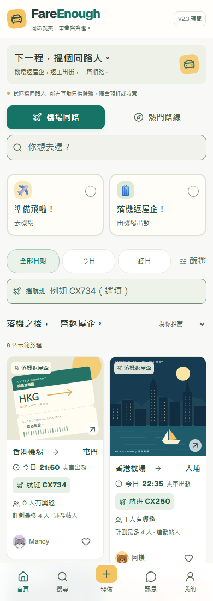](screenshots/mobile-01-homepage.png) | [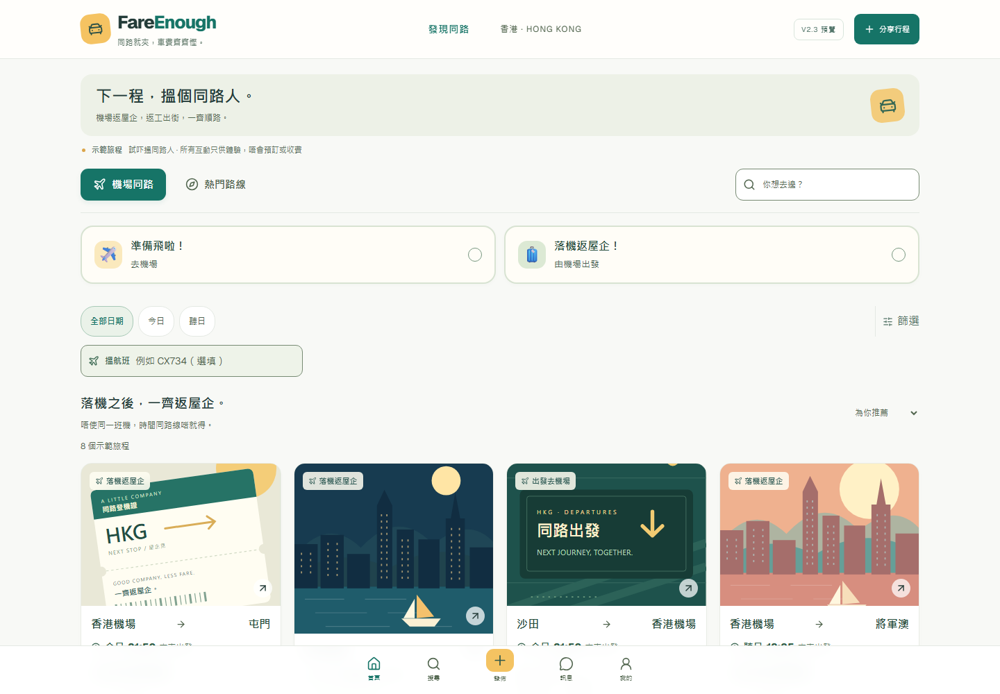](screenshots/desktop-01-homepage.png) |
| **Airport search** Selected 落機返屋企！ direction plus destination search and normalized `cx 734` flight filter; one synthetic matching journey. | [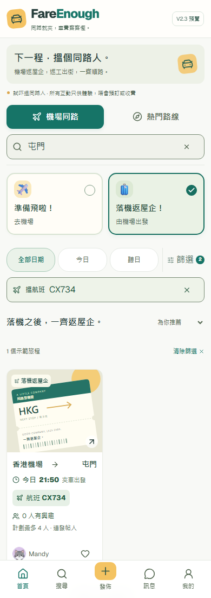](screenshots/mobile-02-airport-search.png) | [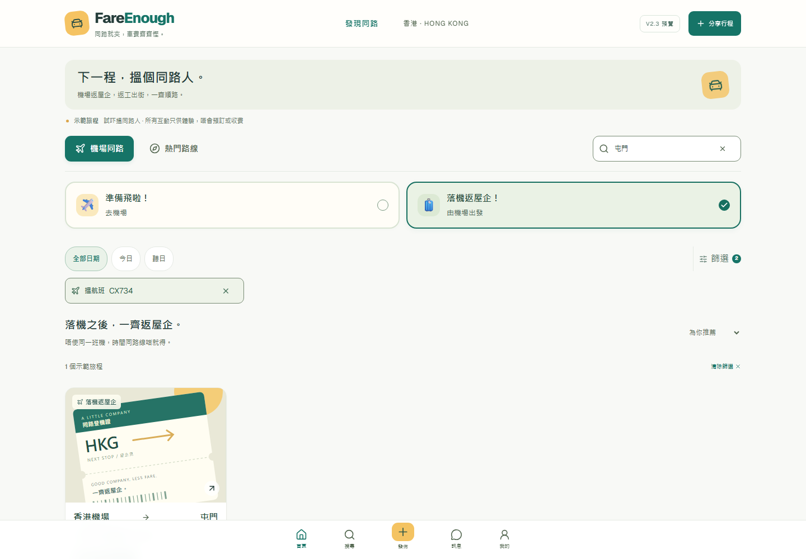](screenshots/desktop-02-airport-search.png) |
| **Airport filters** Common district/planned places/direction filters, with selected advanced conditions folded away. Places are not confirmed remaining seats. | [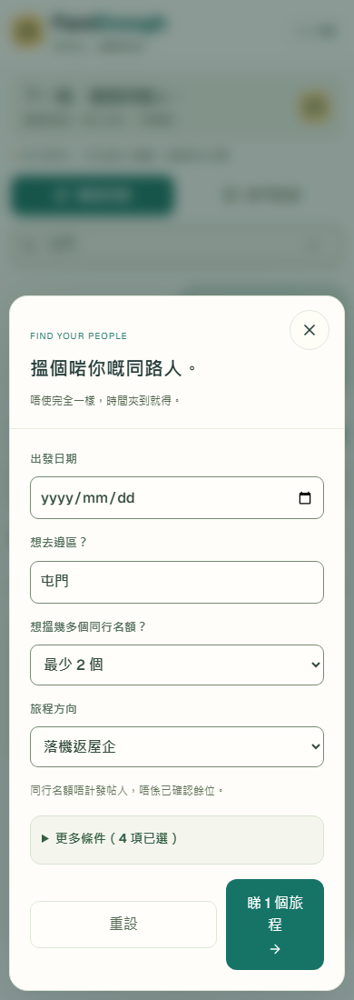](screenshots/mobile-03-airport-filters.png) | [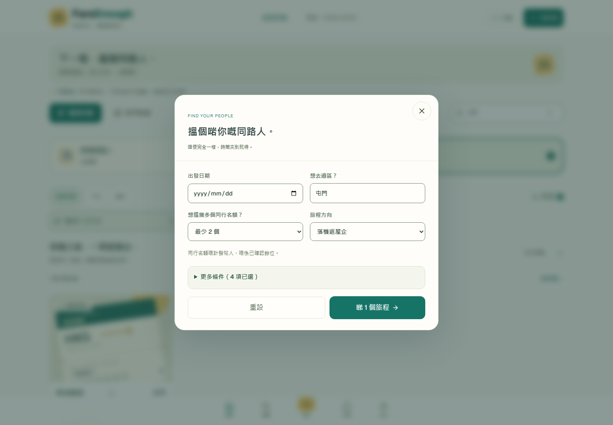](screenshots/desktop-03-airport-filters.png) |
| **Popular routes** The 屯門 → 中環 corridor; both one-off and recurring demo journeys are discoverable. | [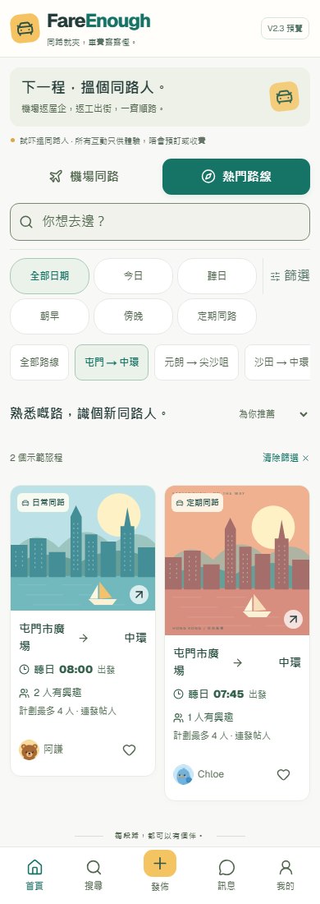](screenshots/mobile-04-popular-routes.png) | [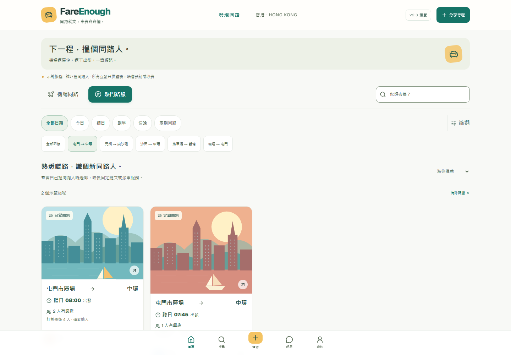](screenshots/desktop-04-popular-routes.png) |
| **Arrival journey details** Full uncropped illustration and journey overview. Lower airport timing/interest information appears in the before/after states. |  | [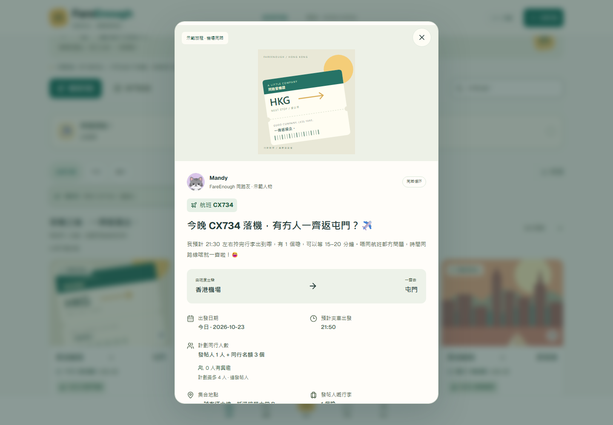](screenshots/desktop-05-journey-details.png) |
| **Create Post — step 1** Essential fields first; optional trip details are collapsed. |  | [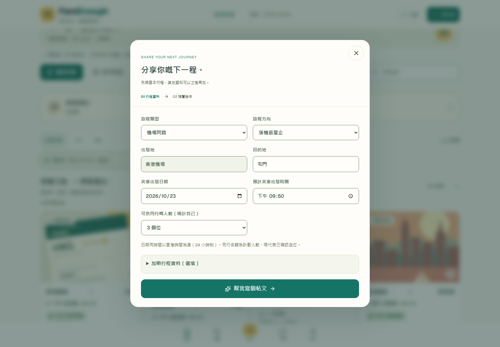](screenshots/desktop-06-create-step-1.png) |
| **Create Post — preview** Compact full-date car departure summary, editable Cantonese copy, optional flight timeline/cover, and normal-flow publish action. | [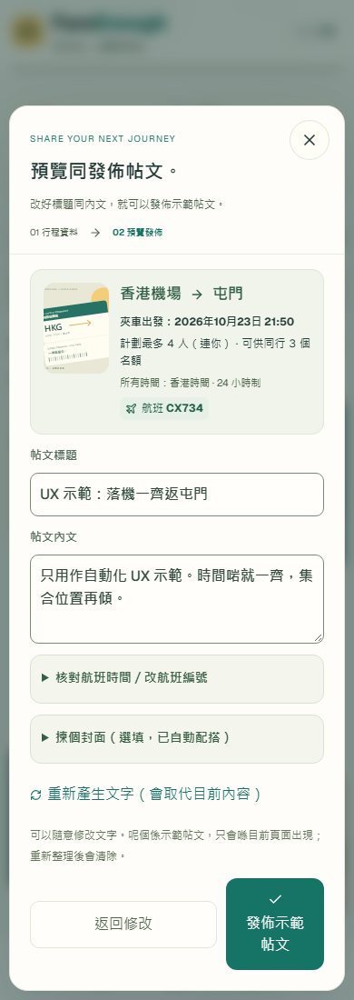](screenshots/mobile-07-create-step-2.png) | [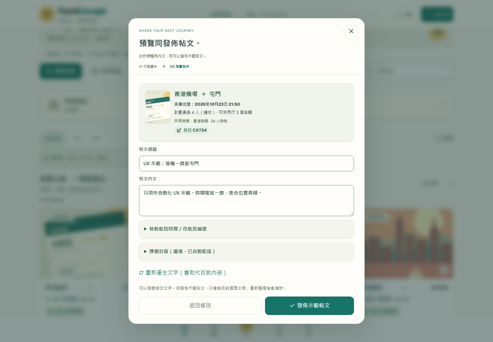](screenshots/desktop-07-create-step-2.png) |
| **Interest — before** Another person's journey: zero interested people, maximum planned group of four, and 我有興趣. |  | [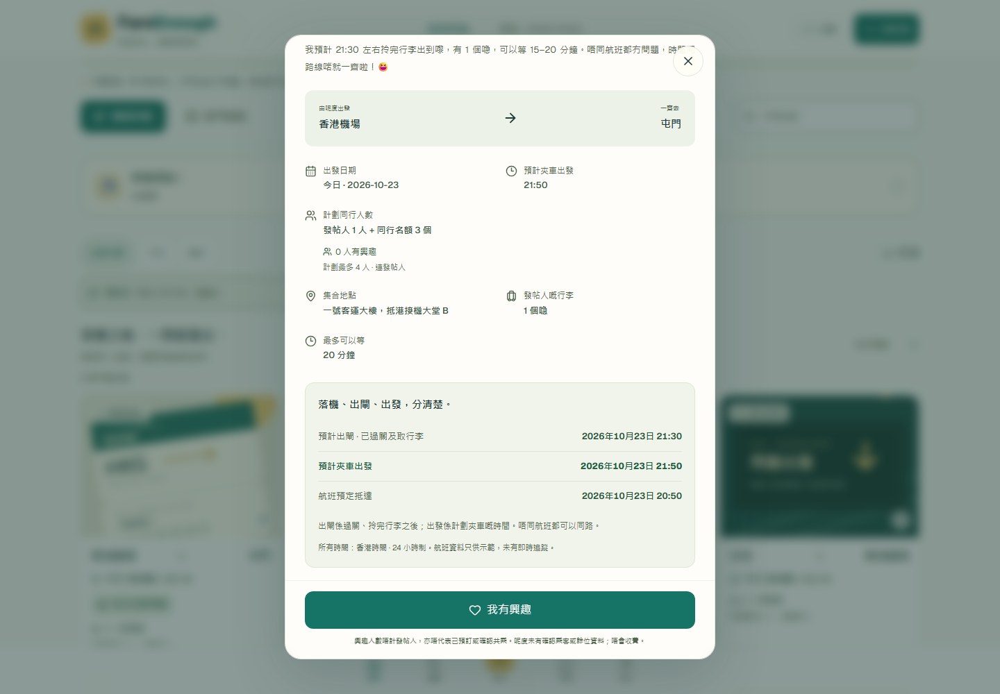](screenshots/desktop-08-interest-before.png) |
| **Interest — after** The same viewport after interest: one interested person, capacity still four, and 撤回興趣. | [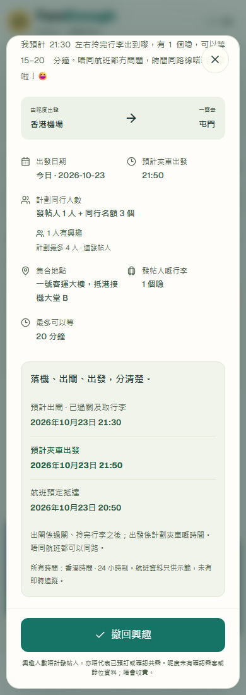](screenshots/mobile-09-interest-after.png) |  |
| **My Journeys** One local published journey and one interested journey, with the refresh warning. |  | [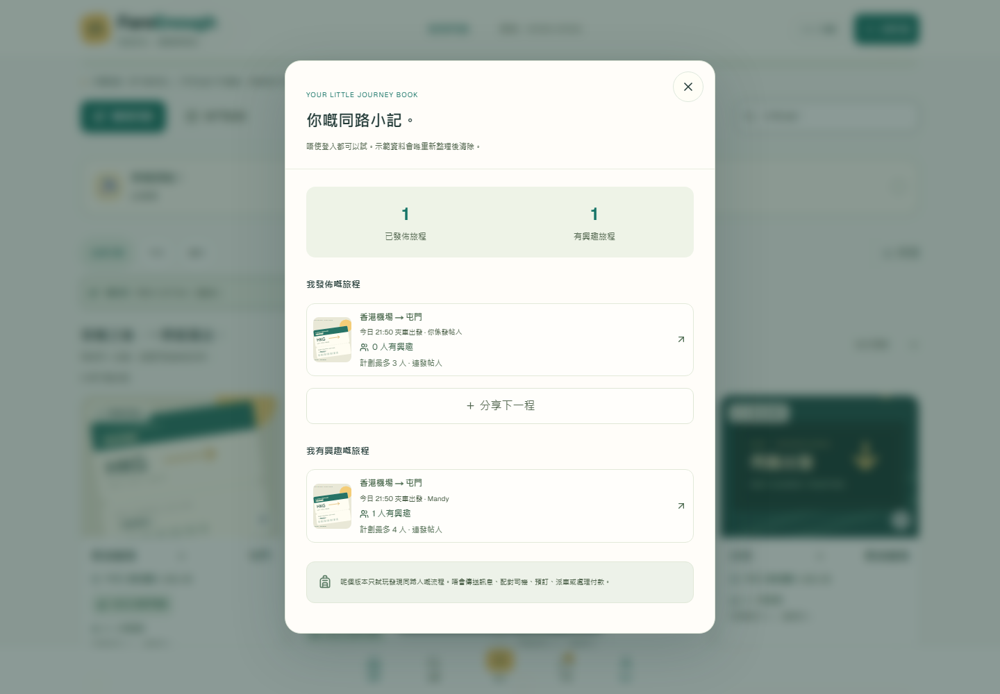](screenshots/desktop-10-my-journeys.png) |
